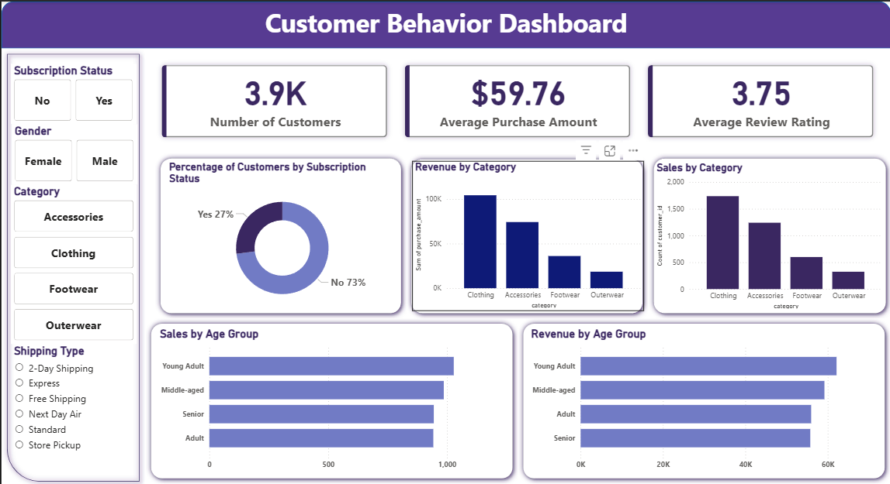

# Customer Shopping Behavior Analysis

End-to-end retail analytics project: **Python** for cleaning and feature engineering, **SQL Server** for business queries, **Power BI** for an interactive dashboard, plus a written report and executive summary deck.



## Business Problem

A retail company wants to understand how customers shop, so it can improve sales, satisfaction and loyalty. The question this project answers:

> *How can the company leverage consumer shopping data to identify trends, improve customer engagement, and optimize marketing and product strategies?*

The full brief is in [`docs/business_problem.pdf`](docs/business_problem.pdf).

## Dataset

[`data/customer_shopping_behavior.csv`](data/customer_shopping_behavior.csv) holds **3,900 purchases and 18 columns**:

| Group | Columns |
|---|---|
| Customer | Customer ID, Age, Gender, Location, Subscription Status |
| Purchase | Item Purchased, Category, Purchase Amount (USD), Size, Color, Season |
| Behavior | Review Rating, Shipping Type, Discount Applied, Promo Code Used, Previous Purchases, Frequency of Purchases, Payment Method |

## Tools Used

| Stage | Tool |
|---|---|
| Data cleaning and feature engineering | Python (pandas, NumPy, SQLAlchemy) in Jupyter |
| Business analysis | SQL Server (T-SQL) |
| Dashboard | Power BI |
| Reporting | PDF report and PowerPoint executive summary |

## Project Workflow

1. **Data preparation (Python)**
   - Filled 37 missing `Review Rating` values with the median rating of each product category
   - Standardized column names to `snake_case`
   - Created `age_group` (four equal-sized quartile groups) and `purchase_frequency_days` (text frequency converted to days)
   - Dropped `promo_code_used`, which was identical to `discount_applied` on every row
   - Loaded the cleaned table into SQL Server
2. **Analysis (SQL)** – 10 business questions covering revenue by gender, discount behavior, top-rated products, shipping, subscriptions, customer segments, top products per category and revenue by age group. See [`sql/customer_behavior_queries.sql`](sql/customer_behavior_queries.sql).
3. **Visualization (Power BI)** – KPI cards, subscription split, revenue and sales by category and by age group, with slicers for subscription status, gender, category and shipping type.
4. **Reporting** – a full written report and an executive summary deck.

## Key Findings

- **Revenue:** $233,081 across 3,900 purchases, with an average purchase of $59.76 and an average rating of 3.75.
- **Spend per purchase is nearly flat** across gender, age group, category, shipping type and subscription status, so growth depends on more buyers and more repeat purchases rather than bigger baskets.
- **Subscriptions:** only 27% of customers subscribe, and subscribers spend about the same as non-subscribers ($59.49 vs $59.87).
- **Discounts:** 43% of purchases used one, yet discounted orders are about the same size as full-price orders ($59.28 vs $60.13).
- **Loyalty segmentation:** with the cut-offs used (New = 1, Returning = 2–10, Loyal = 11+), 80% of customers land in "Loyal", which limits how useful the label is.
- **Categories:** Clothing contributes 45% of revenue; Outerwear is the weakest at about 8%.
- **Data quality flag:** in this dataset, all subscribers are male and no purchase by a woman carries a discount. This should be verified at the data source before acting on it.

## Recommendations

The report suggests, mostly as tests rather than proven conclusions (there is no cost or profit data):

1. Make the subscription more valuable, starting with non-subscribers who already have more than 5 purchases
2. Test limiting discounts on the most discount-dependent products (Hat, Sneakers, Coat, Sweater, Pants)
3. Replace the single "Loyal" group with tiered loyalty levels
4. Promote products that already sell well and test a fix for Outerwear
5. Run small targeted tests on Young Adults (18–31) and Express-shipping customers

## Repository Structure

```
customer-shopping-behavior-analysis/
├── README.md
├── requirements.txt
├── .gitignore
├── data/
│   └── customer_shopping_behavior.csv
├── docs/
│   └── business_problem.pdf
├── notebooks/
│   └── customer_shopping_behavior_analysis.ipynb
├── sql/
│   └── customer_behavior_queries.sql
├── dashboard/
│   └── customer_behavior_dashboard.pbix
├── reports/
│   ├── analysis_report.pdf
│   ├── executive_summary.pdf
│   └── executive_summary.pptx
└── images/
    └── dashboard_preview.png
```

## How to Run

1. Clone the repo and install dependencies:
   ```bash
   git clone https://github.com/<your-username>/customer-shopping-behavior-analysis.git
   cd customer-shopping-behavior-analysis
   pip install -r requirements.txt
   ```
2. Open `notebooks/customer_shopping_behavior_analysis.ipynb` and run the cells to clean the data. The notebook reads the CSV from `data/`.
3. The last cells load the cleaned table into a local SQL Server Express instance (`localhost\SQLEXPRESS`, database `customer_behavior`, table `customer`) using Windows authentication. Adjust the server name if yours differs.
4. Run the queries in `sql/customer_behavior_queries.sql` against that database.
5. Open `dashboard/customer_behavior_dashboard.pbix` in Power BI Desktop.

## Author

**Ashish**
